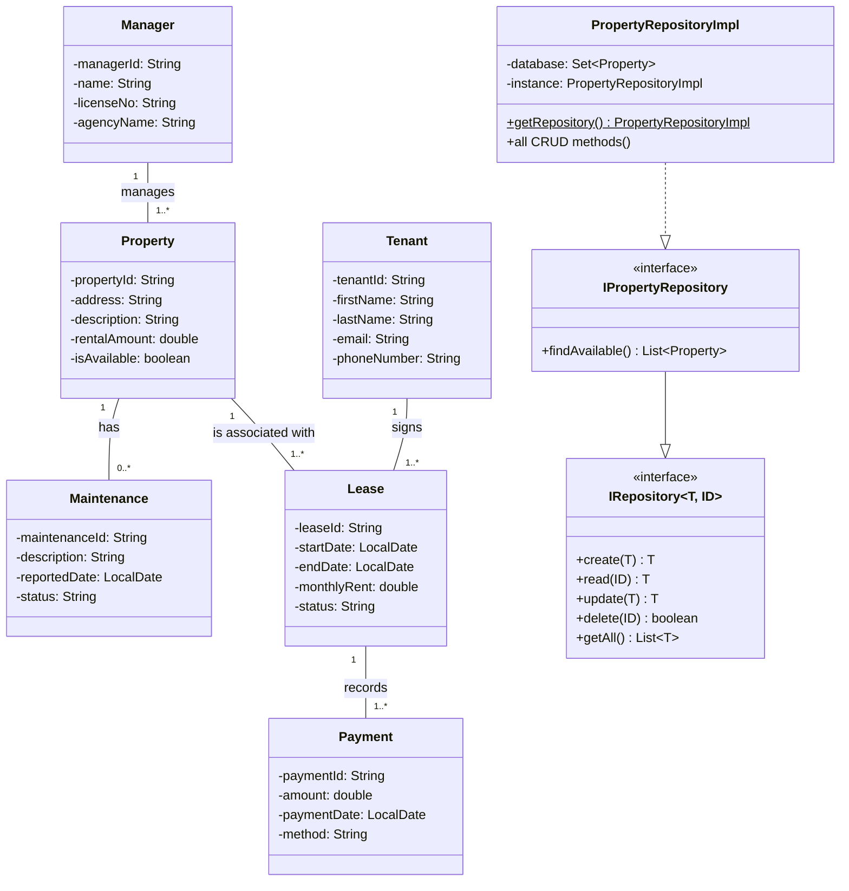

Persistent storage, the Supabase connection, and local startup are documented in [docs/database.md](docs/database.md). The HTTP API is documented in [docs/api-standards.md](docs/api-standards.md). Supabase Auth, signing keys, and organisation roles are documented in [docs/authentication.md](docs/authentication.md). The bounded contexts are in [docs/architecture.md](docs/architecture.md).

The Maven project root is this directory. Do not activate the `local` profile against Supabase. The diagram below is the original coursework model. The running API uses the JPA adapters described in the architecture document.

## Local development

Supabase Auth and the PostgreSQL database stay hosted online. This computer runs only the React app and the Java API.

From the project folder:

```powershell
powershell -ExecutionPolicy Bypass -File .\scripts\start-portico.ps1
```

You can also double-click `scripts\start-portico.cmd`. The script finds the project folder itself.

It asks for the Supabase database password once, and only when the API is not already running. The password is typed into a masked prompt, passed to the API window through the process environment, then removed from the launcher. It is not saved to disk, not printed, and not given to the React process. `frontend/.env` is left unchanged.

The launcher then waits until `http://localhost:8080/actuator/health` reports UP. If the API process exits with an error, the launcher says startup failed. A window opening is not treated as success.

The API window runs the existing backend script. Maven `clean` in that script deletes only the local `target` folder. Flyway then validates the applied V1 migration. It does not clean or reset Supabase. The API window prints the database host, port, database name, and username. It does not print the password.

Leave these two windows open. They show the logs.

| Window | Address |
| --- | --- |
| Portico Frontend | http://localhost:5173 |
| Portico API | http://localhost:8080 |

The launcher records the two window process ids in `.portico/session.json`. That folder is gitignored and contains no password. If a port is already serving this project, the launcher does not start a second copy.

Stop only those recorded windows:

```powershell
powershell -ExecutionPolicy Bypass -File .\scripts\stop-portico.ps1
```

Or double-click `scripts\stop-portico.cmd`. The stop script checks that each recorded process still belongs to this project, then closes that process tree. It does not stop other Java, Node, or PowerShell programs.


